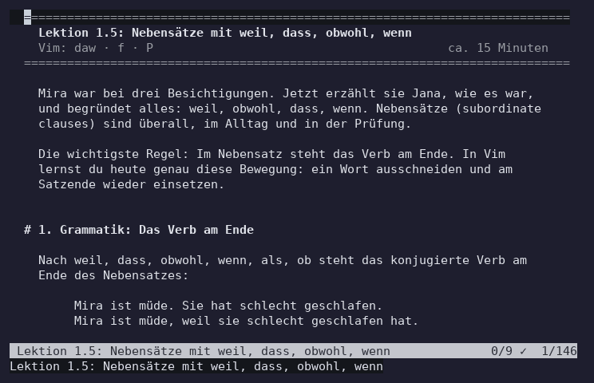

# VimGermanTutor

**vimtutor for German.** Learn the grammar you need for the
**Goethe-Zertifikat B2**, starting from solid B1, and learn the editor Vim at
the same time, from zero.

Every Vim command is practised right away on a German sentence, and the
command usually *is* the grammar step:

- `e` jumps to the end of a word, where the adjective ending is; `r` fixes it.
- `daw`, `f.`, `P` move the verb to the end of a *weil*-clause.
- `~` capitalises *lernen* into *das Lernen*.
- `*`, `cgn`, `n`, `.` add the *-n* of the n-Deklination exactly where it
  belongs.
- One recorded macro forms the Konjunktiv I of six verbs (and fails on *tun*,
  which is a lesson in itself).



## How it works

- **One command starts it** and gives you a fresh copy of the lesson. You
  cannot break the original.
- **The file is the playground.** You read it top to bottom and move through
  it with the keys it has just taught you.
- **Every exercise line starts with `--->`.** Numbered steps above it say what
  to press.
- **You see whether you got it right.** While you edit, the line gets a **✓**
  (matches an accepted answer) or a **✗** (edited, not right yet) in the sign
  column; untouched lines get nothing. The status line shows the tally, e.g.
  `6/8 ✓`. Several answers are accepted where German allows them.
- **The answer is hidden in a closed fold** right below the exercise. Try
  first, then open it with `zo`.
- **Progress is kept** between sessions. `:GermanTutor` resumes where you
  stopped; `:GermanTutorProgress` lists what you have done.
- **Short lessons** (10 to 15 minutes, 6 to 10 exercises), a summary at the end
  of each lesson, and a review lesson at the end of each chapter.
- The examples follow one person, Mira, who moves to Leipzig: flat hunting,
  the Bürgeramt, a job search, colleagues, the news, and finally the B2 exam.

## Install

You need **Vim 8.2+** or **Neovim 0.9+**, on Linux, macOS or Windows (gVim,
Vim in Windows Terminal, Neovim in Windows Terminal).

### Linux and macOS

Vim:

```sh
git clone https://github.com/thejusmahajan/vimgermantutor ~/.vim/pack/germantutor/start/vimgermantutor
```

Neovim:

```sh
git clone https://github.com/thejusmahajan/vimgermantutor ~/.local/share/nvim/site/pack/germantutor/start/vimgermantutor
```

The shell command (optional, works for either editor):

```sh
ln -s ~/.vim/pack/germantutor/start/vimgermantutor/bin/vimgermantutor ~/.local/bin/vimgermantutor
```

(If you cloned into the Neovim path, link from there instead.)

### Windows

Vim or gVim (in `cmd.exe`):

```bat
git clone https://github.com/thejusmahajan/vimgermantutor %USERPROFILE%\vimfiles\pack\germantutor\start\vimgermantutor
```

Neovim (in `cmd.exe`):

```bat
git clone https://github.com/thejusmahajan/vimgermantutor %LOCALAPPDATA%\nvim\pack\germantutor\start\vimgermantutor
```

In PowerShell, write `$env:USERPROFILE` and `$env:LOCALAPPDATA` instead of
`%USERPROFILE%` and `%LOCALAPPDATA%`. For the shell command, add the plugin's
`bin` folder (for example
`%USERPROFILE%\vimfiles\pack\germantutor\start\vimgermantutor\bin`) to your
`PATH`; it contains `vimgermantutor.cmd`.

With Vim 8.2 on Windows, put `set encoding=utf-8` at the top of your vimrc
(Vim 9 and Neovim use UTF-8 already). In Windows Terminal, `Ctrl-v` pastes
instead of starting block mode; use `Ctrl-q` in Vim instead.

### With a plugin manager

```vim
" vim-plug
Plug 'thejusmahajan/vimgermantutor'
```

```lua
-- lazy.nvim
{ 'thejusmahajan/vimgermantutor' }
```

## Start

Inside Vim or Neovim:

```vim
:GermanTutor          " resume where you stopped (or start with lesson 1.1)
:GermanTutor 2.3      " a lesson by number
:GermanTutorProgress  " what you have done
:help germantutor     " the manual
```

From a shell, like `vimtutor`. It starts Neovim if it is installed, else Vim,
and uses no vimrc, so every key does what the lesson says:

```sh
vimgermantutor            # resume
vimgermantutor 2.3        # a lesson
vimgermantutor --vim      # Vim even if Neovim is installed
vimgermantutor --nvim     # Neovim
```

On Windows: `vimgermantutor.cmd` with the same arguments. Both also run
straight from a clone: `bin/vimgermantutor` or `bin\vimgermantutor.cmd`.

Terminal without ✓ and ✗? `:let g:germantutor_ascii = 1` shows `ok` and `x`.

## Lessons

33 lessons in 5 chapters: the grammar and the Vim commands each lesson
teaches.

**Kapitel 1: Ankommen (B1-Wiederholung)**

| | Deutsch | Vim |
|---|---|---|
| 1.1 | Dativ-Präpositionen | `h j k l`, `zo zc`, `x`, `:q!` |
| 1.2 | Der Genitiv | `i`, `a`, `A`, `:wq`, digraphs |
| 1.3 | Adjektivendungen | `w`, `b`, `e`, `r` |
| 1.4 | Reisen und Verkehr (Wechselpräpositionen, trennbare Verben) | `dw`, `d$`, counts, `dd`, `p`, `u`, `Ctrl-r` |
| 1.5 | Nebensätze: weil, dass, obwohl, wenn | `daw`, `f`, `P` |
| 1.6 | Relativsätze | `J`, `o`, `O` |
| 1.7 | Wiederholung Kapitel 1 | |

**Kapitel 2: Auf dem Amt**

| | Deutsch | Vim |
|---|---|---|
| 2.1 | Konjunktiv II: Bitten, Wünsche, Ratschläge | `cw`, `ce`, `C` |
| 2.2 | Das Passiv | `/`, `n`, `N`, `?`, `Ctrl-o` |
| 2.3 | Konjunktiv II der Vergangenheit | `.` |
| 2.4 | Passiv mit Modalverben | `:s`, `:%s///gc`, `V` + `:s` |
| 2.5 | Futur I und II, Vermutungen | `gg`, `G`, `:42`, `Ctrl-g` |
| 2.6 | Subjektive Modalverben | `d/wort`, `c/wort` |
| 2.7 | Wiederholung Kapitel 2 | |

**Kapitel 3: Jobsuche**

| | Deutsch | Vim |
|---|---|---|
| 3.1 | Arbeit und Beruf (Anrede, Gruß, Komposita) | `yy`, `yw`, `p`, `P` |
| 3.2 | Verben und Adjektive mit Präpositionen, da- und wo-Wörter | `ciw`, `caw`, `diw`, `daw` |
| 3.3 | n-Deklination | `*`, `cgn`, `n`, `.` |
| 3.4 | Infinitivsätze: zu, um/ohne/statt … zu | `t`, `;`, `ct.`, `dtp` |
| 3.5 | Doppelkonnektoren | `Ctrl-v`, `I`, `J`, `c3w` |
| 3.6 | Wiederholung Kapitel 3 | |

**Kapitel 4: Im Büro und in den Nachrichten**

| | Deutsch | Vim |
|---|---|---|
| 4.1 | Medien und Nachrichten | `v`, `V` |
| 4.2 | Indirekte Rede | `q`, `@`, `@@`, `0` |
| 4.3 | Partizipialattribute | `"a`, `"ap`, `:reg`, `df,` |
| 4.4 | Nominalisierung | `~`, `cis`, `das` |
| 4.5 | Nomen-Verb-Verbindungen | `Ctrl-n`, `Ctrl-p` |
| 4.6 | Meinungen äußern und argumentieren | `g Ctrl-g`, `vip`, `:w datei` |
| 4.7 | Wiederholung Kapitel 4 | |

**Kapitel 5: Prüfungstraining (Goethe-Zertifikat B2)**

| | Deutsch | Vim |
|---|---|---|
| 5.1 | Die Prüfung im Überblick, Lesestrategie | `ma`, `'a`, `:set hlsearch` |
| 5.2 | Schreiben Teil 1: Forumsbeitrag (mit Timer) | `:GermanTutorTimer`, `gqip`, `g Ctrl-g` |
| 5.3 | Schreiben Teil 2: Formelle Nachricht (mit Timer) | `V` + `:s`, `gv`, `:iabbrev` |
| 5.4 | Sprechen Teil 1: Vortrag | `zf`, `zM`, `zR`, `zd` |
| 5.5 | Sprechen Teil 2: Diskussion | `:sort`, `ddp` |
| 5.6 | Generalprobe: Wiederholung und 75 Minuten Schreiben | |

The lessons themselves say `Strg` (the German key label) for `Ctrl`.

The exam chapter describes the format as the Goethe-Institut publishes it
(module times, parts, word counts, pass mark), in its own words. Check the
current description on goethe.de before you register. Nothing is copied from
Goethe model papers, textbooks or vimtutor.

## Is the German right?

Every exercise was written together with its accepted answers, and every
German sentence was then read again in a separate review pass. The points that
are still not certain are listed in [REVIEW.md](REVIEW.md), for a teacher or a
native speaker to check.

## Tests

`test/run.vim` runs headless in Vim and Neovim. Among other things it checks
that every lesson loads; every `--->` line has a fold with an answer; every
accepted answer passes the checker and every untouched exercise fails it;
there is no BOM, no tab, no timestamp and no line wider than 76 columns; every
"Weiter" pointer names the next lesson; CRLF checkouts work; `:GermanTutor`
makes a copy and leaves the original untouched; progress and resume work.
`test/recipes.vim` types the keys a lesson teaches (macros, `cgn`, `:s///gc`,
block mode, `:sort` …) and checks that they really solve the exercise.

```sh
sh test/run.sh vim
```

```sh
sh test/run.sh nvim
```

GitHub Actions runs the tests on Ubuntu and Windows with Vim and Neovim, plus
the oldest supported versions (Vim 8.2.0000 and Neovim 0.9.5) on Ubuntu, and
tests `bin\vimgermantutor.cmd` with `cmd.exe` on Windows.

The demo GIF is made by `media/make-demo.sh` (tmux, Neovim, Pillow, ffmpeg).

## Licence

MIT, see [LICENSE](LICENSE).
